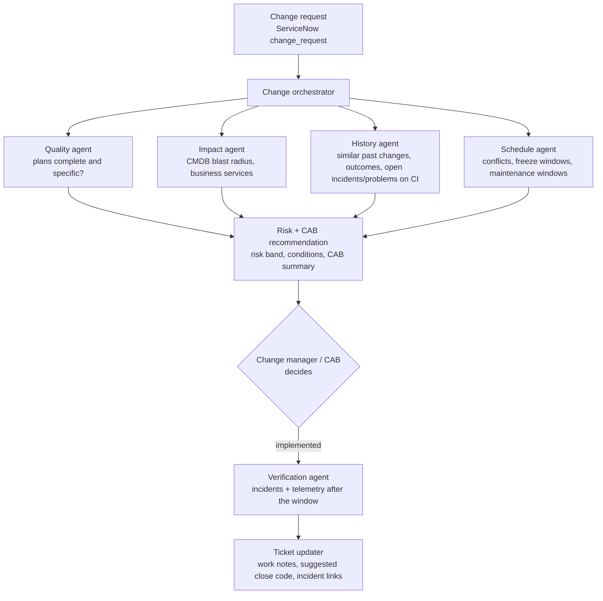

# Design: agentic change management on ServiceNow

Status: agreed (2026-11-19). Follows on from
[agentic-aiops-servicenow-azure](https://github.com/asampath1/agentic-aiops-servicenow-azure) (v1.0, incidents).

## 1. Problem

Badly controlled changes cause many incidents. In the v1.0 dataset, 27 of 296 resolved incidents were caused by a
recent change. Yet change review is mostly manual:

- **Assessing each request.** A change manager reads every request. They check that the implementation, backout and
  test plans make sense, then work out what could break.
- **Rating risk.** Risk is set by a questionnaire the requester fills in about their own change, so it is often too
  low.
- **Checking conflicts.** The change advisory board (CAB) checks clashes with other changes and freeze periods by hand.
  For a retailer, the main freeze periods are sale events.
- **Verifying afterwards.** Post-implementation review is often skipped. A change is closed "successful" even when it
  caused incidents the next morning.

## 2. What the project shows

AI agents prepare each change for the CAB with evidence, and check it afterwards. People still make every approval
decision.

| Agent | Input | Output |
|---|---|---|
| Quality | description, implementation / backout / test plans, window | missing or weak sections (e.g. backout "N/A", no test step) |
| Impact | CI, CMDB relationships, services | affected CIs and business services, highest service tier |
| History | past changes of the same kind / CI / group, incidents they caused, open incidents and problems on the CI | failure rate with evidence (change numbers) |
| Schedule | all changes in the window, freeze and maintenance schedules | conflicts (same CI / dependent CI), freeze overlap, out-of-window |
| Risk + recommendation | the four reports | risk band (low / moderate / high), recommendation (standard path / approve with conditions / full CAB / send back), reasons, a CAB summary |
| Verification | implemented change, incidents opened afterwards on affected CIs, telemetry | suggested close code (successful / with issues / unsuccessful), linked incidents (caused_by) |

## 3. Guardrails

- **The AI never approves.** It writes a recommendation and evidence. It never moves a change to Scheduled /
  Implement, and never changes the approval record.
- **The requester's risk is kept.** The agent's risk goes into its own field or a work note, so reviewers can compare
  the two.
- **Writes are dry-run by default.** As in v1.0, ServiceNow writes happen only with `--write`.
- **Answer keys stay hidden.** Agents never read `ground_truth.json`, and a test enforces this. Fields on open
  changes that hold the answer are redacted, for example the outcome and the CAB decision.
- **Verification is conservative.** "Unsuccessful" and incident links are suggestions in work notes, not hard writes,
  unless the evidence is direct (same CI, inside the window, matching symptom).

## 4. Data (synthetic, same fictional company)

ShopKart Retails is reused. It keeps the same users, groups, CMDB, services, KB and incident history, so the two
projects tell one story. The generator is copied and extended:

- **Richer change requests.**
  - Types: standard, normal and emergency.
  - Text fields: justification, implementation plan, backout plan and test plan, with good, weak and missing
    versions.
  - Planned and actual window, requester risk and lead time.
- **Schedules.** Freeze windows tied to SKR sale events (for example a festive sale freeze and month-end finance
  close), plus maintenance windows per tier.
- **Outcomes from a hidden model.**
  - Each change has a true failure probability. It is computed from factors the agents can see (service tier, blast
    radius, change kind, group track record, plan quality, freeze/conflict, business-hours window, open problems on
    the CI) plus noise.
  - The outcome is drawn from that probability. Failed changes create incidents afterwards, which the verification
    agent must find.
  - Agents never see the weights.
- **History.** About 6 months of closed changes with outcomes, for the History agent to learn from.
- **Eval set (target size).**
  - About 40 open changes (state Assess). Answers: risk band, expected recommendation, conflicts, quality flags.
  - About 20 implemented, not-yet-closed changes for verification. Answers: outcome and caused incidents.
  - A "messy" subset where the main signal is only in free text, for example "rollback not possible after schema
    migration". This is where a Claude reasoner should beat the heuristic.

## 5. Evaluation

| Metric | Why it matters |
|---|---|
| **Missed high risk**: truly high-risk changes recommended for the standard path | The safety metric (like "unsafe actions" in v1.0); target 0 |
| Risk band accuracy and macro F1 | Overall calibration |
| Over-escalation rate: low-risk changes sent to full CAB | CAB time wasted; the trade-off against missed high risk |
| Conflict and freeze detection precision / recall | Deterministic checks should be near-perfect |
| Quality flag F1 | Weak or missing plans |
| Verification: outcome accuracy, caused-incident link precision / recall | Closing the loop |

Baselines:
- The heuristic reasoner, offline, with no credentials.
- The Claude reasoner (`claude-opus-5-5`) on the same set, once an API key is bought. Its summaries will be graded
  separately on factuality: every claim must cite a change, incident or CI.

## 6. Live part: ServiceNow PDI

There is no Azure part. The v1.0 Azure environment is torn down, and the trial ends in mid-December 2026. The
ServiceNow PDI is free:

- Load the dataset into `change_request`. Use the PDI's freeze ("blackout") schedules where they exist, otherwise a
  custom table. Check these on the instance before relying on them.
- Run the agents live and write work notes plus the AI risk field.
- An unused PDI is reclaimed after about 10 days, so the loader must rebuild it from scratch (as in v1.0).

## 7. Reused from v1.0 (copied, fresh history)

| From v1.0 | Change |
|---|---|
| `synthetic-data/generate_data.py`, `patterns.py`, `load_to_snow.py` | add change fields, schedules, the outcome model, the eval split |
| `agents/connectors/servicenow.py`, `local.py`, `base.py`, `kb_parse.py` | add change reads and writes, schedules, conflicts |
| `agents/models.py`, `retrieval.py` (BM25), `reasoner.py` (heuristic / Claude) | extend the models; new prompts |
| `agents/change.py` (change-to-incident correlation) | becomes the core of the verification agent |
| `evaluation/score.py`, `tests/test_answer_key_isolation.py` | new metrics; same isolation rule |
| `CLAUDE.md` conventions, dry-run `--write`, synthetic tag | same. The new tag is `SYNTH-SKR-CHG` so both datasets can live on one PDI |

Not reused: the incident triage, diagnostics and remediation agents, the Azure Automation runbooks and the Logic App.

## 8. Milestones

| # | Deliverable | Needs |
|---|---|---|
| M1 | Data generator v2: change history, schedules, outcome model, eval set, ground truth. **Done 2026-11-19** ([details](../synthetic-data/README.md)) | offline |
| M2 | Quality, Impact, History, Schedule and Risk agents; scoring; heuristic baseline committed. **Done 2026-11-19** ([results](../evaluation/README.md)) | offline |
| M3 | Verification agent and its eval. **Done 2026-11-19** ([results](../evaluation/README.md#post-implementation-verification)) | offline |
| M4 | Load to PDI, live run, work notes on changes | PDI |
| M5 | (optional) Claude reasoner comparison | API key, about $2–5 |
| M6 | README, plain-language overview, short demo video, tag v1.0 | — |

## 9. Decisions

- Repo name: `agentic-change-management-servicenow` (decided 2026-11-19).
- No Azure part; ServiceNow PDI and offline evaluation only (decided 2026-11-19).
- Eval size: 40 changes to assess + 20 to verify (default; can change in M1).
