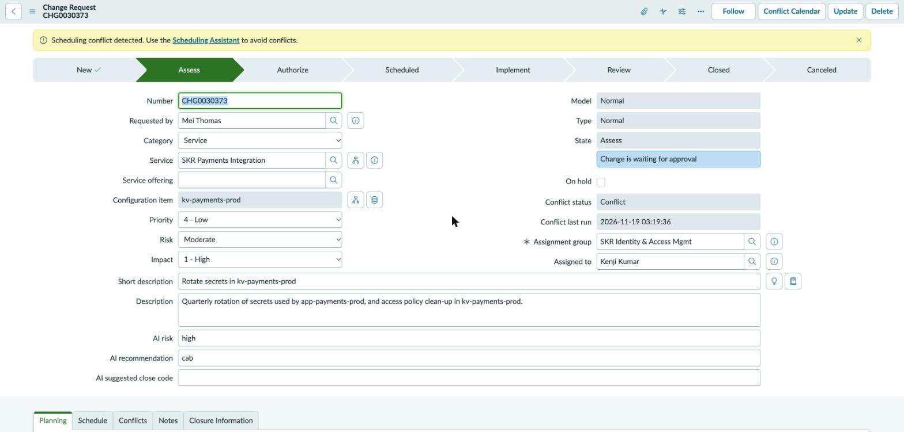
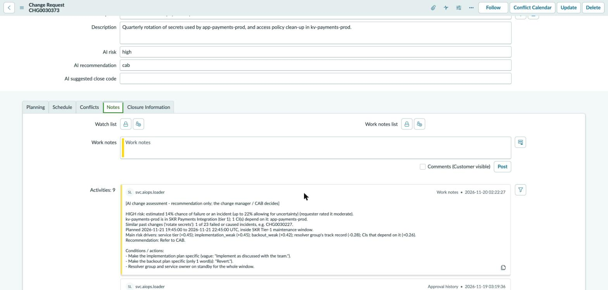
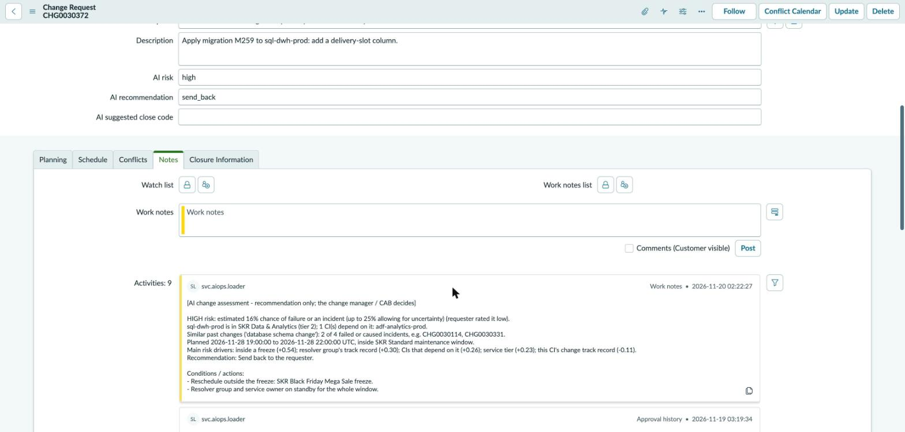
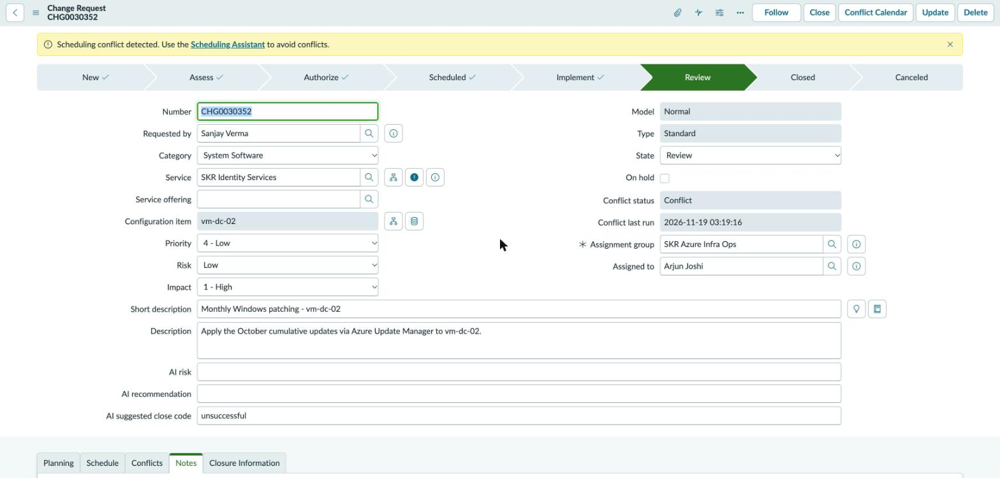
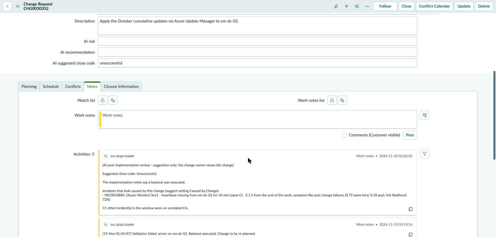

# Live run on ServiceNow (M4)

On 2026-11-20 I ran the agents against a ServiceNow Personal Developer Instance (PDI) loaded with the same synthetic
data as the offline tests. They read the change requests, CMDB, schedules, incidents and the change policy over the
REST API, then wrote their results back to the changes. All data is synthetic (fictional company ShopKart Retails).

```bash
python -m agents --source servicenow --write --out runs/pdi-write
python -m evaluation.score runs/pdi-write --truth synthetic-data/data/ground_truth.loaded.json
```

## What was written

| | Changes | Written to ServiceNow |
|---|---|---|
| Assessment (changes waiting for approval) | 40 | work note + `AI risk` + `AI recommendation` |
| Post-implementation review (changes in Review) | 20 | work note + `AI suggested close code` |

All 60 updates returned HTTP 200. I then checked the instance itself: every one of the 60 changes has its AI
fields set and exactly one AI work note. The AI never approves, closes or moves a change; the notes say so at the top.

## Results: same as offline

| Metric | Offline | Live PDI |
|---|---|---|
| Missed high-risk changes | 1 of 12 | 1 of 12 |
| Recommendation accuracy | 65% | 65% |
| Send-backs correct | 9 of 9 | 9 of 9 |
| Missed failures (verification) | 0 of 8 | 0 of 8 |
| Close code accuracy | 90% | 90% |
| Caused-incident links (precision / recall) | 0.78 / 0.70 | 0.78 / 0.70 |

The bands and recommendations are identical; estimated probabilities differ by at most 0.015 because a few problem
records reused from my earlier project carry their original dates.

## What it looks like

**A high-risk change referred to CAB.** The AI fields sit under the description.



The work note gives the estimate with its uncertainty, the services that depend on the CI, how similar past changes
went, the schedule check, the main risk drivers, and what to fix before CAB (here: vague implementation and backout
plans).



**A change sent back** because it is planned inside the Black Friday change freeze.



**A post-implementation review.** The patching change's notes say the backout was run, so the suggested close code is
Unsuccessful, and the heartbeat incident on the same server two hours later is proposed as caused by the change.
The change owner decides.





## Things the PDI needed

- The PDI's change model forces new API-inserted changes to New and blocks state changes over REST. The loader
  generates a background script (`fix_change_states.js`, run once by hand) that sets the planned states.
- Schedule span times are stored in the instance time zone (IST); the loader converts them.
- Work notes are a journal, so `--write` was run exactly once.
